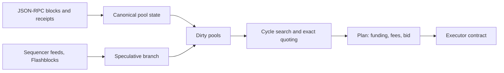

<p align="center">
  
</p>

<h1 align="center">Rosetta</h1>

<p align="center">Cyclic DEX arbitrage for Arbitrum Nitro and OP Stack chains.</p>

<p align="center">
  <a href="https://github.com/Rorical/Rosetta/actions/workflows/ci.yml"></a>
  <a href="LICENSE"></a>
  
</p>

Rosetta follows one L2 chain over JSON-RPC and its sequencer feeds, keeps an in-memory model of the DEX pools it tracks, searches closed token cycles whenever a pool changes, and executes profitable cycles as one atomic call to its own executor contract. It can run as a pure observer, as a paper trader that simulates every plan against chain state, or as a live searcher that signs and bids within hard fee and principal limits.

> [!WARNING]
> Live mode signs transactions and spends real funds. Arbitrage on these chains is competitive and most attempts lose to faster or better-funded searchers. Run shadow mode first, keep only bounded funds in the hot wallet and the executor, and read [SECURITY.md](SECURITY.md) before going live.

## Features

- **Chains.** Arbitrum One and Robinhood Chain (Nitro family), OP Mainnet, Base, Unichain and Ink (OP Stack family). Fee and ordering rules follow the chain family; see [docs/chains.md](docs/chains.md).
- **Protocols.** Uniswap V2 and V3 forks, Camelot V3 (Algebra), Aerodrome/Velodrome Slipstream, Velodrome V2, Solidly V3, Uniswap V4 pools without hooks, MetricOmm pools, and native-token wrapping. All swap math is integer-exact and checked against on-chain fixtures.
- **Pre-confirmation inputs.** Arbitrum Fast Feed and the standard sequencer feed, OP Stack Flashblocks (Subblocks on Unichain) feed a speculative branch that search can read without touching canonical state.
- **Search.** A precomputed cycle catalog, dirty-pool invalidation, staged screening, amount optimization and exact re-quoting at the final tip; see [docs/search.md](docs/search.md).
- **Execution.** One executor transaction per opportunity with wallet, flash-loan, flash-swap and inventory funding, conditional transactions on quiet pools, multiple nonce lanes, and a bid model that prices tips against win probability; see [docs/execution.md](docs/execution.md).
- **Safety.** Mandatory per-transaction and daily fee caps, per-asset principal caps, a stop file, a token transfer-tax registry and pool quarantine. Signing keys stay in AWS Secrets Manager, Google Secret Manager or an explicit keystore.
- **Operations.** Prometheus metrics and alert rules, a control socket, and a key-less web console that can pause plan delivery.

## How it works



One process serves one chain. Canonical state advances only from whole blocks whose parent matches; blocks sealed from a feed enter on probation and are checked against RPC. Speculative data lives in a separate branch so a bad feed can never corrupt canonical state. [docs/architecture.md](docs/architecture.md) covers the full pipeline and package layout.

## Quick start

Requirements: Go 1.25. Foundry, Node.js 22, Rust and Python are needed only for the contract, console, OP cross-check and bid-model checks.

```sh
git clone https://github.com/Rorical/Rosetta.git
cd Rosetta
make build
```

Follow Arbitrum One, search for cycles and write candidates without signing anything:

```sh
./bin/rosetta -network arbitrum-one \
  -rpc "$L2_RPC_URL" \
  -event-source sequencer \
  -pool-catalog configs/arbitrum-one-catalog.json \
  -search-config configs/arbitrum-one-search.json \
  -candidate-out candidates.jsonl \
  -metrics-listen 127.0.0.1:9090
```

`L2_RPC_URL` is any Arbitrum One JSON-RPC endpoint; the network preset's public endpoint works for a short trial but makes no rate-limit promises. Paper trading, reactive shadow mode and live sending are described in [docs/configuration.md](docs/configuration.md).

To deploy the executor contract, see [contracts/README.md](contracts/README.md).

## Repository layout

| Path | Contents |
|---|---|
| `cmd/rosetta` | The engine, one process per chain |
| `cmd/rosetta-console` | Web console for one or more instances |
| `cmd/` (others) | Offline audit and probe tools; none of them sign or send |
| `internal/` | Engine packages, layered as described in [docs/architecture.md](docs/architecture.md) |
| `contracts/` | Executor contract (Solidity, Foundry) |
| `web/` | Console frontend (TypeScript, Vite), embedded into `rosetta-console` |
| `configs/` | Public pool catalogs, search and policy configs, example reactive configs |
| `deploy/prometheus/` | Prometheus scrape config and alert rules |
| `scripts/` | Bid-model training and paper-run maintenance (offline Python) |
| `testdata/` | Chain fixtures and golden replay cases |

## Documentation

| Document | Covers |
|---|---|
| [Architecture](docs/architecture.md) | Process model, package layers, data flow |
| [State and sync](docs/state-and-sync.md) | Canonical state, speculative branches, reorgs, snapshots |
| [Search](docs/search.md) | Cycle catalog, screening, sizing, exact quoting |
| [Execution](docs/execution.md) | Executor contract, funding, fees, sending, bidding |
| [Chains](docs/chains.md) | Supported chains, ordering, fee rules, feeds |
| [Configuration](docs/configuration.md) | Flags, environment variables, config files, signing, operations |
| [Testing](docs/testing.md) | Test layers, fixtures, golden replays |
| [Bid learning](docs/bid-learning.md) | Optional GBDT bid model |
| [Decision records](docs/adr/README.md) | Why the design is the way it is |
| [Glossary](docs/glossary.md) | Terms used across the code and docs |

## Contributing

Bug reports, fixes, new DEX adapters and new chains are welcome. Read [CONTRIBUTING.md](CONTRIBUTING.md) for setup, checks and conventions, and follow the [code of conduct](CODE_OF_CONDUCT.md). Report vulnerabilities privately as described in [SECURITY.md](SECURITY.md).

## License

Rosetta is licensed under the [Apache License 2.0](LICENSE).
