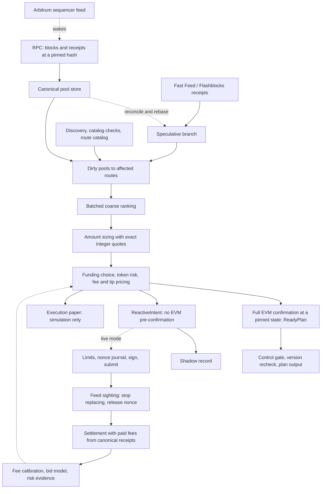

# Architecture

Rosetta is a cyclic DEX arbitrage engine for L2 chains. One process follows one chain through JSON-RPC, keeps an in-memory model of the pools it tracks, searches closed token cycles whenever pools change, and turns profitable cycles into a single atomic call to an executor contract.

This document covers the process model, package layers and the path from chain input to a sent transaction. The details live in companion documents:

| Topic | Document |
|---|---|
| Canonical state, speculative branches, reorgs, snapshots | [state-and-sync.md](state-and-sync.md) |
| Route catalog, ranking, amount sizing, exact quoting | [search.md](search.md) |
| Executor contract, fees, reactive sending, nonces, bidding | [execution.md](execution.md) |
| Chain identities, ordering and fee rules | [chains.md](chains.md) |
| Flags and configuration files | [configuration.md](configuration.md) |
| Terms | [glossary.md](glossary.md) |

## Scope

Rosetta supports two chain families:

| Family | Chains | Ordering |
|---|---|---|
| `nitro` | Arbitrum One, Robinhood Chain | Arbitrum One orders by priority fee; Robinhood orders by arrival |
| `op-stack` | OP Mainnet, Base, Unichain, Ink | Priority fee |

The family decides how blocks are followed, how candidates are confirmed and how fees are budgeted. A chain ID never selects another family's semantics; the configuration accepts only `nitro` and `op-stack`, and requires a parent chain ID that is nonzero and different from the chain's own (`internal/config/network.go`).

Rosetta does not:

- execute blocks locally, derive L2 state from L1, or run a node in-process. The configured RPC endpoint is the source of canonical blocks, receipts and the state used for confirmation;
- read a public mempool, trade across chains, or combine DEX and CEX venues;
- model the whole EVM state. The pool store covers only pools of supported protocols;
- price pools it has no adapter for. V4 pools with hooks, and protocols without an adapter in `internal/dex`, stay out of the graph.

## Process model

```text
cmd/rosetta ──flags──> internal/config
     │
     └─ bot.Run(remote.Factory)
          ├─ resolve network, Create(runtime)
          ├─ check runtime identity against the configured family and chain ID
          └─ runtime.Run: check eth_chainId, bootstrap pools, start workers
```

`cmd/rosetta` reads every runtime parameter from flags (`internal/config/flags.go`) and hands `remote.Factory` to `internal/bot`. The bot only checks identity and runs the lifecycle; it imports no RPC, feed or storage code. `chain.Factory` returns a dormant runtime, and `Runtime.Run` acquires every resource and joins every worker before it returns (`internal/chain/runtime.go`).

All chains use the same backend, `internal/remote`. It assembles the RPC clients, feed clients, state writer, search workers, confirmation and the reactive sender. Keeping assembly in one package lets the shared packages (`state`, `arb`, `planning`, `exec`) stay free of transport code and lets a backtest drive the same state transitions and search without a network.

Within the process, one goroutine owns the pool store and applies every state change in order. Feed readers, the RPC follower, search workers, confirmation workers and the dispatcher run on their own goroutines and communicate through bounded queues and immutable views. Search never writes pool state, and the writer never waits for search.

### Event sources

`-event-source` selects what wakes the follower and what feeds speculative state (`internal/remote/backend.go`):

| Source | Family | Behavior |
|---|---|---|
| `rpc` | any | Poll the RPC endpoint for new blocks |
| `sequencer` | `nitro` | The standard sequencer feed signals new blocks; the follower reads them by RPC. An optional Arbitrum Fast Feed connection adds per-transaction receipts |
| `flashblocks` | `op-stack` | A Flashblocks stream with full receipts drives a speculative branch and can seal canonical blocks, which RPC samples |

`auto` picks `flashblocks` when a Flashblocks URL is set, otherwise `rpc`. The Fast Feed requires Nitro and an explicitly measured first-index mapping, because the feed's transaction positions are not block indexes and the offset differs by chain (see [chains.md](chains.md#fast-feed-index-mapping)).

## Package layers

Dependencies point one way. New imports must not reverse an arrow or create a cycle.

```text
cmd/rosetta          -> {bot, remote, telemetry}
cmd/rosetta-console  -> {console, web}
cmd/<offline tools>  -> shared packages; never remote
bot         -> {chain, config, domain}
chain       -> {config, domain}
remote      -> shared packages; RPC, feeds and signers are assembled only here
pipeline    -> {arb, backtest, dex, domain, exec, graph, ingest, math, pool, simulate, state, telemetry}
planning    -> {arb, dex, domain, exec, pool, telemetry}
discovery   -> {bootstrap, dex, domain, graph, math, pool, rpc}
catalog     -> {bootstrap, dex, domain, exec, pool}
ingest      -> {dex, domain, feed, rpc, state}
backtest    -> {arb, domain, graph, ingest, math, pool, state}
bootstrap   -> {dex, domain, pool, state}
exec        -> {domain, rpc, tokenrisk}
state       -> {dex/slipstream, dex/uniswapv3, domain, pool}
arb         -> {domain, graph, math, pool}
graph       -> {domain, pool}
simulate    -> {domain, pool}
dex         -> {dex/<protocol>, domain, pool}
dex/<protocol> -> {domain, math, pool}
pool        -> {domain, math}
feed        -> {domain}
rpc         -> {domain}
telemetry   -> {rpc}
control     -> {config, telemetry}
console     -> {control, domain, telemetry}
bidreport, paperreport      -> {domain, exec}
config, tokenrisk, poolrisk -> {domain}
domain, math, bidmodel, rundir -> no internal imports
```

| Package | Owns | Does not |
|---|---|---|
| `internal/domain` | Shared types and invariants: addresses, `PoolKey`, block references, chain identity, versions, sentinel errors | Perform I/O or import other internal packages |
| `internal/config` | Flag parsing, network presets, validation | Hold global state |
| `internal/chain` | `Factory` and `Runtime` lifecycle contracts | Import any execution client |
| `internal/bot` | Identity check and lifecycle | Contain RPC, feed or storage logic |
| `internal/remote` | The RPC backend: follower, feed handling, state writer, discovery, confirmation, execution paper, reactive runtime, bid estimator | Hold node state; let speculative state borrow canonical confirmation |
| `internal/rpc` | JSON-RPC client, batching, retries, request pacing and budgets, bounded read cache | Carry business semantics or sign |
| `internal/feed` | WebSocket transport and frame decoding for the Arbitrum sequencer feed, Fast Feed and OP Flashblocks | Read state or make trading decisions |
| `internal/ingest` | Applying receipt logs to pool state: canonical transaction branches, Fast and log branches, reconciliation | Perform network I/O or search |
| `internal/state` | The pool store: shallow and deep state, deterministic event application, dirty tracking, undo, snapshots | Perform I/O, read the clock or randomness |
| `internal/pool` | Pool state types and the `Adapter` quote contract | Contain protocol math |
| `internal/dex`, `internal/dex/<protocol>` | Protocol registration, shared decoding, per-protocol loaders, event handling and quotes | Import `arb` or `exec` |
| `internal/math` | Q96 fixed point, tick math, V3 swap math, constant-product quotes, cycle estimates | Depend on any pool type |
| `internal/graph` | Token/pool adjacency, the route catalog, dirty-pool postings, background exploration | Decide profitability |
| `internal/arb` | Ranking, amount sizing, exact quoting, the search worker | Sign or send |
| `internal/simulate` | Local quoting through adapters | Hold keys |
| `internal/pipeline` | Search scheduling, confirmation queues, research and paper bookkeeping, topology builds | Parse raw transactions or own a concrete state store |
| `internal/planning` | Funding selection, valuation, fee-aware plan and intent construction, tip selection | Hold execution state or read moving `latest` state |
| `internal/exec` | Executor calldata, fee models, ready plans and reactive intents, signing, nonce journal, submission, settlement | Find routes |
| `internal/discovery`, `internal/catalog` | Finding pools from factory creation logs and verifying configured catalogs at a pinned block | Run on the hot path |
| `internal/tokenrisk`, `internal/poolrisk` | Persistent evidence of short-paying tokens and quarantined pools | Certify a token as safe |
| `internal/bidmodel` | Bounded inference for trained bid models | Depend on execution, RPC or pool state |
| `internal/backtest` | Capture and replay of recorded blocks through the same state and search code | Change production behavior |
| `internal/telemetry` | Fixed-label counters and histograms, Prometheus export, health, heartbeat, profiling | Influence decisions |
| `internal/control` | Per-instance Unix socket and the delivery gate | Enter state transitions |
| `internal/console` | The operator backend of `cmd/rosetta-console` | Hold keys or import `exec` |
| `contracts/` | The executor contract and its Foundry tests | Search |

Only `internal/exec` signs and sends transactions. Tools under `cmd/` other than `rosetta` never sign or send.

## Data flow



### Canonical and speculative state

The follower accepts a block only when its parent is the last accepted head and its receipts are complete. The state writer applies each transaction's logs atomically and publishes a new pool version with the set of changed (dirty) pools.

Fast Feed and Flashblocks receipts update a separate speculative branch on top of the canonical store. That branch never writes canonical state. When the next canonical block arrives, the branch is reconciled: matching transactions are kept, a conflict resets the branch to the new base. A candidate found on the speculative branch carries the branch's identity, and a reset invalidates it. [state-and-sync.md](state-and-sync.md) covers the rules.

### Search

Search is incremental. A prebuilt route catalog maps every pool to the closed cycles through it. When pools change, the worker reads the routes through those pools, ranks them with a cheap shallow model, sizes the best few per funding asset with exact protocol math, and publishes each positive quote as soon as it is ready. Two- and three-hop routes run ahead of longer routes. A background task keeps exploring the graph for longer cycles outside the catalog. [search.md](search.md) has the algorithms.

### Planning and execution

`internal/planning` turns a quoted route into something executable: it chooses the funding mode (wallet, inventory, V3 flash loan, V3 flash swap or V4 flash accounting), prices the transaction fee for the chain family, reprices fee-dependent pools at the chosen tip, and checks the profit floor. Three consumers exist:

| Output | Evidence | Used for |
|---|---|---|
| `exec.ReadyPlan` | Full executor call at a pinned canonical hash (or a verified Flashblocks prefix), fees and versions checked | Plans written for an external consumer through `-plan-out` |
| `exec.ReactiveIntent` | Local quote, cached fees and account state, on-chain guards in the contract | The reactive sender, in shadow or live mode |
| Execution paper | Executor call simulated at a chosen state, off the send path | Measuring how quotes would have executed |

Reactive intents exist because a full RPC simulation per candidate costs more time than a priority or arrival auction allows. The contract's per-leg minimums, price bounds and final profit check carry the safety that the simulation would have provided. [execution.md](execution.md) covers the contract, fees, nonces and bidding.

### Operations

`internal/telemetry` exposes fixed-label counters and latency histograms in Prometheus format, a health endpoint, a heartbeat for the process watchdog and an optional loopback pprof listener.

`internal/control` gives each instance a Unix socket in a private directory. Access to the socket is the authorization boundary. The socket serves status and a persisted delivery gate; the gate is checked where plans leave the process and where the reactive sender takes new work, and it fails closed. It never enters state transitions.

`cmd/rosetta-console` runs as a separate process. It watches instances through their control sockets, keeps per-opportunity detail and an operator audit log in SQLite, and leaves history and alerting to Prometheus. It holds no keys and imports nothing from `internal/exec`.

## Design rules

- Correctness before speed. When state is inconsistent, the runtime resets or stops trading; it does not guess.
- Determinism. The same blocks and configuration produce the same pool state and the same candidates, so recorded blocks can be replayed as regression tests (`internal/backtest`, `testdata/golden/`).
- One source of truth. Canonical state advances only from blocks whose parent chain matches the accepted head; speculative streams update their own branch.
- Global shallow state, deep state on demand. Every tracked pool keeps price, liquidity and fee; tick data is loaded for the windows that quotes need.
- Clear boundaries. Feeds do not read state, state does no I/O, and only `exec` signs.
- Measure before optimizing. Latency claims come with a probe or a benchmark, and the hot path gains no optimization without one.

## Trust boundary

Everything Rosetta knows about the chain comes from the configured RPC endpoint and streams. A faulty node feeds faulty data into pool state and into confirmation. Deployments should use endpoints they trust and should check per chain that the trace and state-override methods used for confirmation behave as expected. Reorg detection covers only the blocks the follower has seen; it is not finality.

## Failure handling

| Failure | Detection | Response |
|---|---|---|
| Feed disconnect | WebSocket close or silence | Reconnect; reset the speculative branch; canonical state continues from RPC |
| Speculative gap or conflict | Non-consecutive Flashblocks index, Fast position conflict | Reset the branch; candidates from it are retired |
| Missing or late receipts | RPC error or `null` result | Retry with backoff; the block is not applied until complete |
| Parent hash mismatch | Follower comparison | Reseed known pools at a fresh pinned tip and rebuild topology |
| State application error | Invariant check | Roll back the transaction; the block is not accepted |
| Submission timeout | Context deadline | Outcome unknown; nonce and budget stay reserved until a sighting, receipt or nonce read resolves it |
| On-chain revert | Receipt status 0 | Book the loss; diagnose short-paying tokens; feed the bid model |
| Nonce consumed by an unknown transaction | Nonce read | Halt the dispatcher |
| Process restart | Startup | Load the pool snapshot if its block is still canonical, otherwise bootstrap; reopen the nonce journal |

## Directory map

```text
cmd/rosetta/          single-chain engine
cmd/rosetta-console/  operator console backend
cmd/routeaudit/       offline audit of missed routes against recorded captures
cmd/paperaudit/       offline aggregation of paper and live settlement journals
cmd/bidaudit/         offline bid analysis
cmd/bidmodel/         cross-checks trained bid model inference
cmd/fastprobe/        measures the Fast Feed index mapping
cmd/capturecheck/     replays captures against recorded outcomes
cmd/cyclebench/       route catalog and search benchmarks
internal/             engine packages (see above)
contracts/            executor contract (Foundry)
configs/              public pool catalogs, search and strategy configuration
testdata/             fixtures and golden replays
web/                  console front end
```

## References

Protocol behavior that Rosetta depends on, for readers who want the primary sources:

- Arbitrum: [reading the sequencer feed](https://docs.arbitrum.io/run-a-node/sequencer/read-sequencer-feed), [Priority Gas Auction](https://docs.arbitrum.io/how-arbitrum-works/priority-gas-auction/pga), [Fast Feed](https://docs.arbitrum.io/how-arbitrum-works/priority-gas-auction/fast-feed), [consuming the Fast Feed](https://docs.arbitrum.io/how-arbitrum-works/priority-gas-auction/consume-fast-feed), [gas and fees](https://docs.arbitrum.io/how-arbitrum-works/deep-dives/gas-and-fees), [chain info](https://docs.arbitrum.io/chain-info).
- Nitro source, used to check feed and conditional-transaction semantics (commit `ccc5c828d9ea22f161efc784bac4d4a6559b7e59`): [feed message types](https://github.com/OffchainLabs/nitro/blob/ccc5c828d9ea22f161efc784bac4d4a6559b7e59/broadcaster/message/message.go), [L2 message parsing](https://github.com/OffchainLabs/nitro/blob/ccc5c828d9ea22f161efc784bac4d4a6559b7e59/arbos/parse_l2.go), [sequencer and condition checks](https://github.com/OffchainLabs/nitro/blob/ccc5c828d9ea22f161efc784bac4d4a6559b7e59/execution/gethexec/sequencer.go), [conditional transaction tests](https://github.com/OffchainLabs/nitro/blob/ccc5c828d9ea22f161efc784bac4d4a6559b7e59/system_tests/conditionaltx_test.go), [L1 pricing](https://github.com/OffchainLabs/nitro/blob/ccc5c828d9ea22f161efc784bac4d4a6559b7e59/arbos/l1pricing/l1pricing.go), [ArbGasInfo](https://github.com/OffchainLabs/nitro/blob/ccc5c828d9ea22f161efc784bac4d4a6559b7e59/precompiles/ArbGasInfo.go).
- OffchainLabs go-ethereum (commit `51d716ccf8293072077feb9764d63d73f5e4ff20`): [conditional options and `-32003`](https://github.com/OffchainLabs/go-ethereum/blob/51d716ccf8293072077feb9764d63d73f5e4ff20/arbitrum_types/txoptions.go).
- OP Stack: [transaction fees](https://docs.optimism.io/op-stack/transactions/fees) (L2 execution, L1 data and operator fees).
- DEX math: Uniswap V3 `TickMath`, `SqrtPriceMath`, `SwapMath` and `FullMath`, which `internal/math` reproduces; Uniswap V4 `PoolManager` and `StateLibrary`; Algebra (Camelot V3); Aerodrome/Velodrome Slipstream and Velodrome V2.
